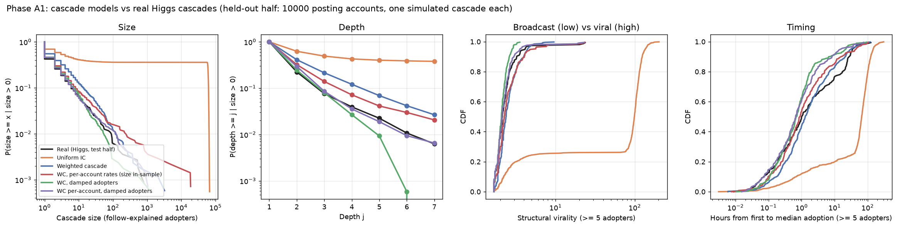
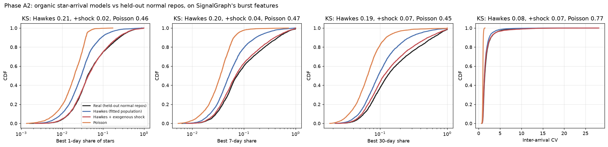
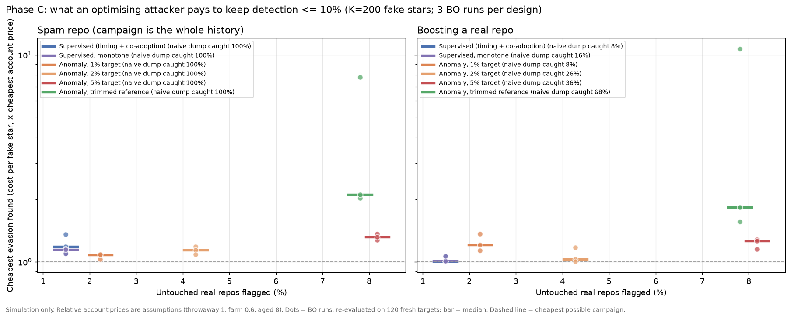

This started as a follow-up to my [Bayesian optimization influence-maximization study](/blog/virality-bo/).
That study asked whether an optimiser could pick better seed accounts than "the accounts with the most
followers." Once corrected, the answer was no: when the spread model is known and simulations are
cheap, simple structure-aware methods win. A reviewer's reply pointed somewhere more useful. The
interesting version of "engineering virality" isn't the marketer's version; it's the manipulator's.
How much does it cost to *fake* a viral signal, and how hard is that to catch?

So I split the question into three parts:

1. **What does organic virality look like?** Any detector learns "unusual" relative to a model of
   "usual", so that model has to be checked against real data first.
2. **How much of virality can anyone control?**
3. **What does it cost a manipulator to get past a detector,** and which detector designs raise
   that cost?

I worked on two platforms:
- **GitHub stars,** where real labelled campaigns exist. *Six Million (Suspected) Fake Stars on
  GitHub*, He et al., ICSE 2026, released its data as the StarScout package.
- **Twitter retweets,** using the SNAP Higgs dataset (the 2012 Higgs-boson announcement week),
  where nothing is labelled.

Everything adversarial in this post happened in simulation.

## Part 1: what organic diffusion actually looks like

### Twitter: real cascades are broadcasts

I rebuilt 20,000 real Higgs cascades. A cascade is everyone who retweeted a given account. Twitter
attributes every retweet to the original author, so who-got-it-from-whom has to be inferred from
the follow graph: each adopter's parent is the most recent account they follow that adopted
before them. That is the approach Goel et al. used in their structural-virality work (*Management
Science*, 2016). I applied exactly the same inference to simulated cascades, so real and simulated
cascades are measured the same way. I fitted the models on half the accounts and compared them on
the other half.

- **The textbook model (independent cascade, one transmission probability) fails badly.**
  Calibrated to the right average, it is still supercritical: 6.6% of posts set off cascades of
  100+ adopters, against 0.06% in reality.
- **A weighted cascade is closer but too viral downstream.** In this model, attention is split
  across everyone a user follows. Real Higgs diffusion is a broadcast: 71% of adopters retweet the
  original poster directly. The calibrated model puts only 32% there.
- **One extra parameter fixes it.** Letting retweeters pass content on at 0.4× the original
  poster's rate reproduces the held-out broadcast share almost exactly (71.4% vs 71.1%). That
  statistic wasn't used to fit the parameter. The model also matches the size tail and structural
  virality.

*Held-out half, 10,000 posting accounts. The damped models (green and purple) track the real
cascades (black); the textbook model (orange) is off the chart.*

This matches what Goel et al. found on a billion Twitter diffusion events: most large spreads are
broadcasts, not chains. One side effect: the BO study's later stage had used the undamped model.
Rerun under the damped one, its conclusions hold (a learning seeder still beats "most followers"
only when accounts differ), and the effects are a little larger.

### GitHub: stars arrive in self-exciting bursts plus one outside shock

For 9,960 normal repositories in StarScout's comparison sample, I fitted three models of when stars
arrive:
- a constant rate;
- a Hawkes process, where each star raises the chance of the next;
- a Hawkes process plus one external shock at the repo's busiest day, such as a front-page post.
  This is the endogenous-vs-exogenous framing of Crane & Sornette (PNAS, 2008).

I judged them on the features a detector looks at: how concentrated stars are in their busiest
1, 7 and 30 days, and how irregular the gaps between stars are. Out of sample, the shock model
reproduces held-out repos within a KS distance of 0.02–0.07. A constant rate is far off (0.46).

Two things fell out of this:
- **A burst alone isn't evidence of manipulation.** A genuine front-page spike can put nearly all of
  a repo's stars into one day, and burst concentration is exactly what simple fake-star detectors
  lean on.
- **StarScout's "normal" sample is contaminated.** 954 of the 9,960 repos (about 10%) received
  50–964 stars within a median of about 15 minutes. Their stargazers are far more often flagged
  for lockstep behaviour elsewhere. Every statistic I could compute says these are campaigns
  StarScout missed. Treating them as clean wrecks any evaluation. StarScout's authors warn that
  their labels are noisy, and this is one concrete form of that.

## Part 2: how much of virality is controllable?

Inside the validated Twitter model:
- **For a single post, luck is large.** It accounts for about 40% of the variation in reach (on a
  log scale), and who posts accounts for the other 60%.
- **For a campaign of 20 seeded accounts, luck averages out to 1–3% of reach**, while the choice of
  accounts moves reach by roughly 97%.

On the real data, with no simulator: before launch, almost everything predictable about a post's
reach is the poster's follower count. Launch-time features reach R² 0.43; follower count alone
reaches 0.39. Once five people have retweeted, adding what those early retweets look like raises
R² to 0.67. That is the gap Cheng et al. described in *Can Cascades Be Predicted?* (WWW 2014).

So "engineering virality" is real at the level of *which accounts* and *campaigns*, not individual
posts. Manufacturing a signal is mostly a matter of buying the right accounts, which is why
detection focuses on accounts.

## Part 3: a detector, and what it takes to beat it

### The detector, built to avoid fooling myself

I lost more time to leakage than to modelling. Three traps:
- **Account profiles.** StarScout fetched profiles mostly for suspected accounts: 72% of flagged
  stargazers have one, against 25% of normal ones. So "has a profile" itself tracks the label.
- **Co-starring computed only within StarScout's repo list.** That list over-represents suspected
  repos, so a fake account's other stars land inside it while a real user's mostly don't.
- **The obvious negatives were trivially different.** Repos StarScout examined and cleared are
  about 100× bigger than campaign repos. Size alone separated them perfectly.

So I rebuilt co-starring from the full public record: for every star, how many *other* repos the
same account starred that day, across all of GitHub, from the public GitHub event archive (GH
Archive in BigQuery). I tested on 2024 data with a model trained on earlier years.

| Detector (2024 hold-out) | AUC | Campaigns caught at a 1% false-flag rate |
|---|---|---|
| Burst concentration only (SignalGraph's current score) | 0.950 | 73% |
| Timing features | 0.959 | 74% |
| Timing + co-starring | **0.993** | **89%** |
| …on campaigns spread over more than a day | 0.989 | 86% |

Co-starring revealed two styles of campaign:
- **Throwaway accounts** that star nothing else that day. 99% of such stargazers, against 44% for
  normal repos.
- **Farm accounts,** every one of which stars 20 or more repos that day.

On Twitter, where there are no real labels, I injected fake retweeters into real cascades instead.
- **The structural tell is strong.** Fake accounts never cause anyone real to retweet: 99.5% of
  first-hop adopters are childless with fakes present, against 86% organically.
- **It weakens as fakes get diluted.** When fakes are under 20% of a cascade's retweeters, only 29%
  are caught.

### Then I let an attacker optimise against it

The attacker is simulated and controls a few things:
- how long the campaign runs;
- how closely its timing copies real repos or cascades;
- which kinds of accounts it buys, each at a stated relative price: cheap throwaways, cheap farm
  accounts, or expensive aged accounts that behave like real users;
- on Twitter, whether fakes follow the target and whether they follow each other in chains.

It searches with Bayesian optimization, and random search with the same budget is the control.
The defender's threshold targets a 1% false-flag rate on untouched real repos or cascades; it
lands at 1.5% on fresh ones.

A sanity check came first. The attacker's default campaign is a 15-minute dump of 200 stars from
throwaway and farm accounts. On throwaway "spam" repos it matches real flagged campaigns on every
key feature, and the detector catches it 100% of the time.

**Result 1: the same dump used to boost a real repo is caught 8–13% of the time.** Real flagged
campaigns mostly sit on throwaway repos, so the detector learned what a fake *repository* looks
like, not what fake *stars on a real repository* look like. The second case is the one someone
evaluating open-source traction actually cares about.

**Result 2: against the trained detector, evasion is almost free.** On GitHub, for every campaign
size from 50 to 1,000 stars, the attacker found campaigns detected 10% of the time or less at
0.60–0.90 per star. The cheapest possible campaign costs 0.60. The winners spread farm accounts over
days or weeks. The detector had only ever seen farm accounts arriving in a burst, so a spread-out
farm campaign was outside anything it learned.

**Result 3: Bayesian optimization is the right tool, for the attacker.** It found evasions at
0.60–0.90 per star where random search needed 0.76–2.89. That is the role the reviewer predicted for
sample-efficient optimisation: a noisy, expensive black box with no structure to exploit.

**Result 4: only defenders that look at accounts or the social graph raise the price.**

- **On GitHub, a supervised detector stays cheap to evade,** and so does one constrained so that
  more farm share or more burst can only raise suspicion.
- **An unsupervised anomaly detector anchored only to normal repos is also cheap to evade at first.**
  The reason is that the "normal" reference itself has a farm-like tail (the contamination again),
  so its threshold sits inside the campaign region.
- **Cleaning the reference is what forces the price up.** I removed suspect normals using a rule
  fixed in advance. The detector then pushes the attacker toward expensive aged accounts: the median
  price roughly doubles, and in one run rises 11×. It also catches 68% of naive boosts. The cost is
  that 7.8% of untouched real repos get flagged.
- **On Twitter, where the detector sees who follows whom and accounts' follower counts, evading
  usually requires aged accounts,** at 4–8× the cheapest price. There are two cheap holes:
  - a fake-only cascade gets past a detector trained only on injections;
  - ten fakes hidden in a small cascade get past the anomaly detector.

**Result 5: retraining helps one round at a time.** Each retrained detector caught 35–82% of the
previous round's campaign, depending on platform. The attacker then re-optimised and evaded again.

## What I take from it

- **A detector trained on today's labels measures today's attackers.** The labelled campaigns are
  crude, so supervised detectors look excellent, and an attacker who optimises against them gets
  through almost for free.
- **Raising the cost of manipulation means forcing the attacker to buy accounts that behave like
  real ones.** In these simulations, that only happened when the detector's evidence was
  account-level or structural, and judged against a clean picture of normal.
- **The price is false flags.** For a diligence tool, which is what my project
  [SignalGraph](/blog/signalgraph-github-fake-star-economy/) is, that argues for "worth a closer
  look, here's why" signals backed by account evidence, not automated verdicts. I've added
  arrival-regularity and co-starring signals to SignalGraph's scoring on a development branch.

## Limitations

- **This is a simulation.** The attacker has a handful of settings, and the account prices are
  assumptions; the aged-account premium drives most of the cost results.
- **Simplified per-star data.** For target repos, per-star co-starring counts are synthesised from
  each repo's real archive aggregates.
- **The Twitter results probably flatter the defender.** Simulated aged accounts copy real follower
  counts, but nobody real follows them, so they can never trigger real retweets. A real bought
  account could.
- **The labels are suspected, not proven.** StarScout's labels mark *suspected* fake stars; I use
  them only in aggregate, and no repository or account is named here.
- **Higgs is one topic in one week of 2012.** The content side of virality (what the post is about)
  is untested.

**On release:** the detector, the organic models and the aggregate cost curves will be public. The
attacker's optimised settings, and anything that works as a ready-made campaign generator, will not.

<!-- TODO before publishing: add the repository link once manufactured-virality is pushed, and an og_image. -->

### References

- He, Yang, Burckhardt, Kapravelos, Vasilescu & Kästner (2026). *Six Million (Suspected) Fake Stars on GitHub: A Growing Spiral of Popularity Contests, Spams, and Malware.* ICSE 2026. Replication package: Zenodo 17009694.
- Goel, Anderson, Hofman & Watts (2016). *The Structural Virality of Online Diffusion.* Management Science 62(1).
- Cheng, Adamic, Dow, Kleinberg & Leskovec (2014). *Can Cascades Be Predicted?* WWW 2014.
- Crane & Sornette (2008). *Robust dynamic classes revealed by measuring the response function of a social system.* PNAS 105(41).
- De Domenico, Lima, Mougel & Musolesi (2013). *The Anatomy of a Scientific Rumor.* Scientific Reports (the Higgs Twitter dataset, via SNAP).
