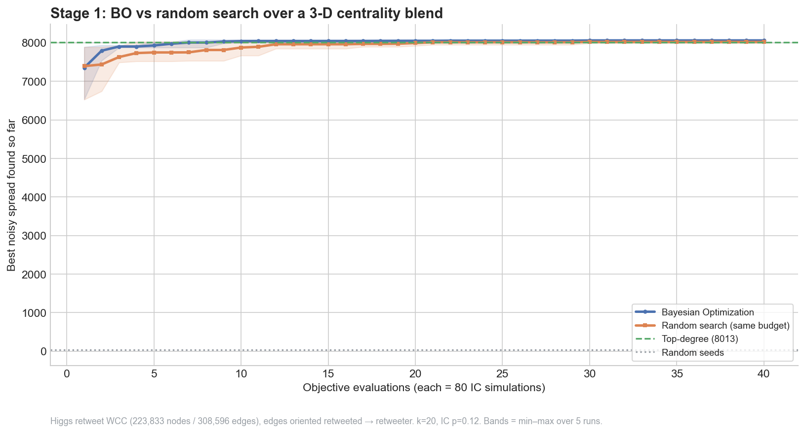
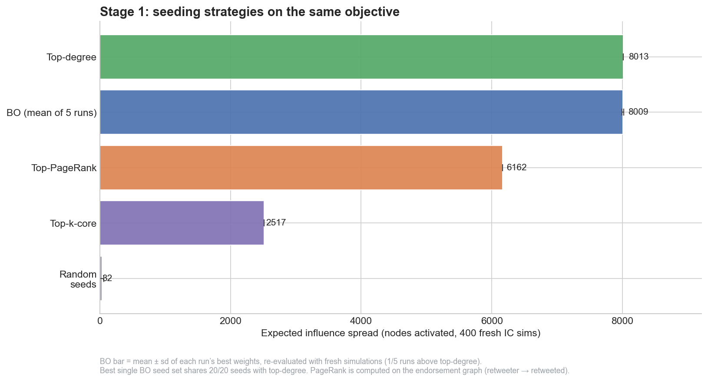
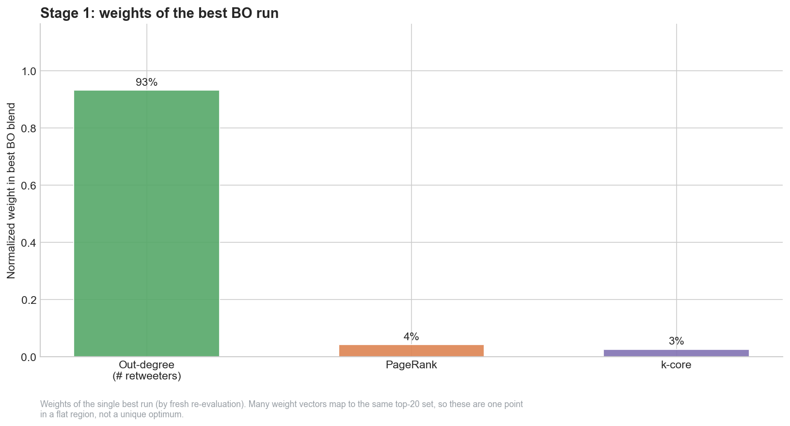
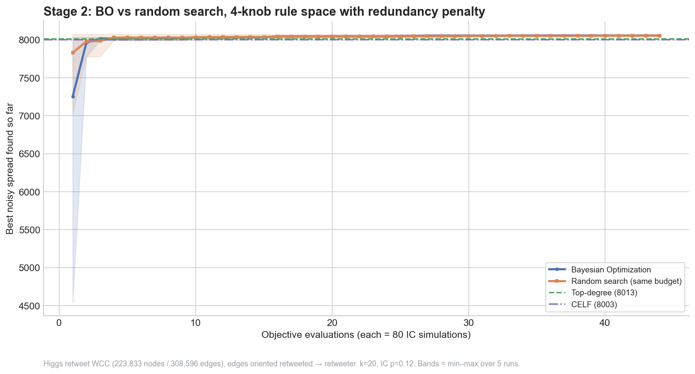
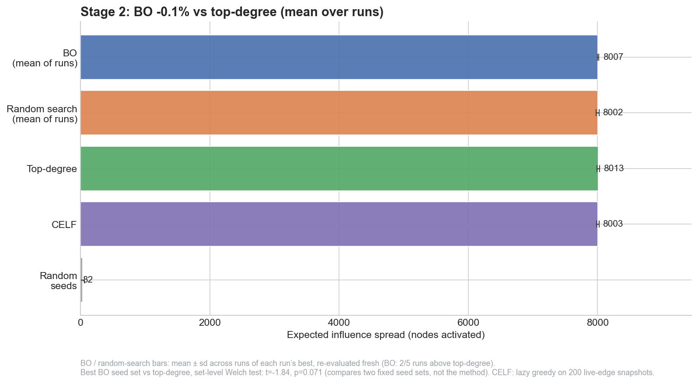
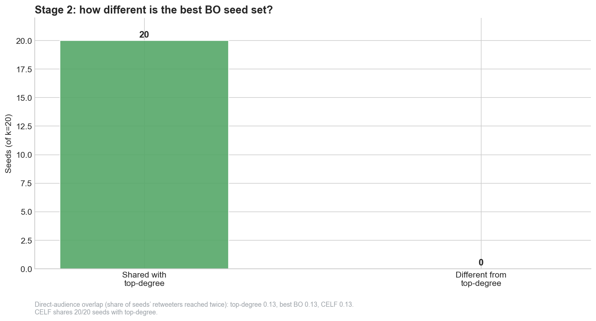
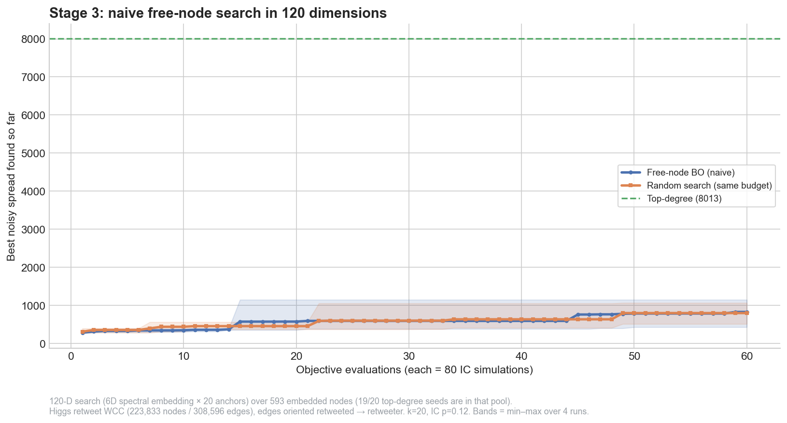
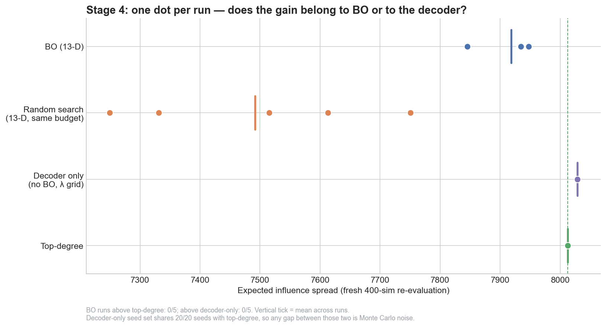
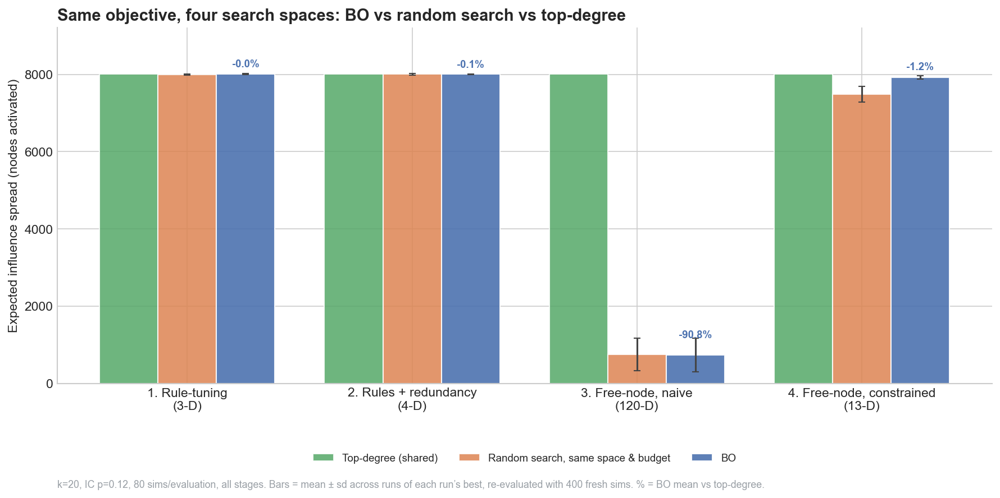

> **Correction, November 2026.** The first version of this post reported that
> Bayesian optimization beat the top-degree heuristic by +2.5% and then +4.5%.
> Those results came from a bug. My graph-building script pointed every edge
> from the retweeter to the account being retweeted, but information flows the
> other way. Every simulated cascade ran backwards, and "top-degree" meant
> "retweeted the most" instead of "was retweeted the most". I fixed the
> direction, tightened the experimental controls, and reran everything. **The
> win does not survive.** This post now reports the corrected results. The
> [changes are listed below](#what-changed-in-the-rerun), and the old version is
> in the site's git history.

> **BLUF:** On the Higgs retweet graph, with edges pointing in the direction
> information actually flows, seeding the 20 most-retweeted accounts is
> effectively optimal. CELF, the standard near-optimal greedy algorithm, picks the
> same 20 accounts. Bayesian optimization never beat that baseline. The search
> space decided how close it got: within 0.1% in small rule spaces, 1.2% short in
> a constrained subset space, and 91% short in a naive 120-dimensional space.
>
> **Key takeaways**
> - Top-degree is very hard to beat here because cascades are shallow and the top accounts' audiences barely overlap.
> - Rule-tuning BO converged on exactly the top-degree seed set.
> - Adding diversity knobs didn't help, because there was almost no redundancy to remove.
> - An unconstrained 120-dimensional node search collapsed for BO and random search alike.
> - BO clearly beat random search only in the hardest well-posed space, where it came close to the baseline but didn't pass it.

Suppose you get to choose twenty accounts on a social network to plant a
message with, and you want it to spread as far as possible. Which twenty?

The obvious answer is *the twenty with the most reach*, meaning the biggest hubs.
On this graph that answer is not just good. It is, as far as I can tell,
essentially the best one.

This post is a build log for a small experiment: using Bayesian Optimization
(BO) to select seed nodes for influence maximization on a real network, over
four differently shaped search spaces. It is also a record of getting the
answer wrong the first time. All the code is on
[GitHub](https://github.com/ChinmayA301/blog-artifacts/tree/main/virality-bayesian-optimization),
and every number below is generated from the pipeline outputs rather than typed by hand.

## The setup

The graph is the [SNAP Higgs Twitter dataset](https://snap.stanford.edu/data/higgs-twitter.html),
specifically the **retweet network**, because retweets are the actual mechanism
by which a message diffuses. After reducing to the largest weakly-connected
component, we have a directed graph of **223,833 nodes and 308,596 edges**.

Direction matters, and it's where I went wrong the first time. SNAP lists an
edge A → B when A retweeted B. Information flows from B to A, so the diffusion
graph has to reverse every edge. Once reversed, a node's out-degree is the
number of accounts that retweeted it.

Spread is measured with the **Independent Cascade (IC)** model. Each newly
activated node gets one chance to activate each of its out-neighbours,
independently, with probability *p* = 0.12. A seed set of *k* = 20 nodes is
scored by the mean number of nodes activated over 80 Monte Carlo cascades. That
mean is a **noisy, expensive, black-box function** of the seed set, which is
exactly the kind of objective Bayesian Optimization exists for.

The controls are the same in every attempt below:

- **One objective:** same *k*, same *p*, same number of simulations per evaluation.
- **One baseline:** the 20 accounts with the most retweeters, scored with 4,000 simulations at **8,012** activated nodes.
- **A fair race:** random search gets exactly the same number of evaluations as BO, in the same space, and the curves are plotted against total evaluations.
- **No best-of-N:** every run's best answer is re-scored with 400 fresh simulations, and I report the mean ± standard deviation across runs.

Other reference points: top-PageRank (6,162), top-k-core (2,517), random seeds
(32), and **CELF**, the lazy-greedy algorithm for influence maximization.

## Attempt 1 - Let BO tune a ranking rule

The space of 20-node subsets is astronomically large, so the first move is to
search a *rule* for ranking nodes rather than the nodes themselves. BO gets
three weights, one each on normalized out-degree, PageRank and k-core, and
optimizes the blend. The top twenty nodes under that blend become the seed set.

*BO reaches the top-degree plateau faster than random search, but the plateau is top-degree itself. Bands span min-max over five runs.*

BO converged quickly. Averaged over runs, it was within 1% of top-degree after
6 evaluations, versus 12 for random search. But what it converged *to* was top-degree:
the best BO seed set shares **20 of 20** accounts with the top-degree set.
Across runs, BO scored 8,009 ± 15 against the baseline's 8,012. That gap is
simulation noise.

*Out-degree dominates. BO rediscovers the heuristic exactly.*

*The best run put about 93% of its weight on out-degree. Many weightings produce the same top-20, so this is one point on a flat plateau, not a unique optimum.*

## Attempt 2 - Give BO room to be different

A ranking can't express anything top-degree can't, so attempt 2 added a
**redundancy penalty**. BO now controls four knobs: two ranking weights, a
penalty that discounts candidates sitting near already-chosen seeds, and how
far that neighbourhood extends. In principle BO can now spread its seeds out.

It didn't need to. BO's best seed set again shares **20 of 20** accounts with
top-degree. Across five runs it averaged 8,007 ± 9, statistically
indistinguishable from the baseline and from random search (8,002 ± 22).

*Everything converges to the same place within a couple of evaluations.*

CELF is the useful sanity check here. Run properly, against 200 fixed sampled
cascades so its lazy-evaluation shortcut is valid, it selects **the same 20
accounts as top-degree**. Two very different methods agreeing is good evidence
that the top-degree set is close to optimal for this graph and *p*.

*BO, random search, CELF and top-degree are all on the same plateau.*

The reason is structural. The top-20 accounts' direct audiences overlap by only
about **13%**, and retweeters are rarely retweeted themselves, so cascades stay
shallow. Spread is close to additive across seeds, and in that regime picking
the biggest hubs is the right move. There is almost no redundancy for a
diversity knob to remove.

*The redundancy penalty had nothing to do.*

## Attempt 3 - Take the training wheels off

Attempt 3 let BO pick **actual nodes**, with no centrality ranking involved. The
candidate pool's largest connected component (593 high-degree nodes) is embedded
into six dimensions with a spectral embedding. BO places twenty anchor points in
that space, and each decodes to its nearest node. That is a 120-dimensional
continuous search that can, in principle, land anywhere.

It collapsed. BO averaged **737 ± 431** activated nodes, about 9% of top-degree,
and random search did no better (748 ± 418). The best BO seed set shares 1 of 20
accounts with top-degree and has almost no audience overlap. That is maximal
diversity and minimal spread.

*Sixty noisy evaluations are nowhere near enough for 120 dimensions. BO and random search are indistinguishable.*

The embedding's geometry has nothing to do with influence. Reach on this graph
is concentrated in a handful of accounts, and almost every point in the
embedding decodes to someone else. Sixty evaluations can't find those few
accounts in a 120-dimensional space.

## Attempt 4 - Diversity, but only among nodes that matter

Attempt 4 restricted the search to the **400 accounts with the most retweeters**.
BO searches 13 dimensions: 12 latent dimensions that bias the ranking of those
accounts, plus a diversity weight. A greedy decoder turns each point into a seed
set. In the first version of this post, this was the +4.5% headline.

After the fix, it is the attempt that tells you most about BO itself, because
I added the two controls the first version lacked:

- **Random search in the same 13-dimensional space with the same budget.** BO
  averaged **7,919 ± 41** across five runs and random search **7,492 ± 204**.
  Every BO run beat every random-search run. In a space where most points are
  bad, BO's model of the objective earns its keep.
- **The decoder with BO switched off.** With no learned bias, sweeping only the
  diversity weight returns exactly the top-degree set. Whatever BO adds in this
  space, it isn't something the baseline was missing.

BO still finishes **1.2% below** top-degree. Its best set swaps one top-degree
account for a slightly worse one.

*One dot per run. BO clearly beats random search but not top-degree. The decoder-only set is the top-degree set, so the gap between those two is noise.*

## The actual finding

| Attempt | Search space | BO vs. top-degree (mean of runs) | Random search, same budget | Best BO seeds shared with top-degree |
|---|---|---|---|---|
| 1. Rule-tuning | 3-D centrality blend | −0.04% | −0.2% | 20 / 20 |
| 2. Rules + redundancy | 4-D | −0.06% | −0.1% | 20 / 20 |
| 3. Free-node, naive | 120-D embedding | **−91%** | −91% | 1 / 20 |
| 4. Free-node, constrained | 13-D over top-400 | −1.2% | −6.5% | 19 / 20 |

*Same objective, four search spaces. BO matches the baseline in small degree-anchored spaces, gets close in the constrained subset space, and collapses in the naive one.*

What survives the correction is narrower than what I originally claimed.

1. **The heuristic was the answer.** On this graph and *p*, top-degree is
   effectively optimal for *k* = 20, and CELF independently agrees. The original
   "BO beats top-degree" margins were artifacts of cascades running the wrong
   way through the graph.
2. **The search space still decides a lot, just not whether BO wins.** It
   decides whether BO can *reach* the optimum. In low-dimensional,
   degree-anchored spaces it finds it in a handful of evaluations. In a naive
   high-dimensional space it never gets close.
3. **BO's advantage over random search depends on the space.** On a flat
   plateau (attempts 1–2) there is nothing to model, and random search does as
   well. In the hard, well-posed space (attempt 4) BO is clearly better. In a
   hopeless space (attempt 3) neither works.

The broader lesson I take from this is about process, not optimizers. The
original version passed my own reading because the story was plausible and the
p-values were small. Those p-values compared two fixed seed sets, so they said
nothing about whether *the method* works, and the whole simulation was
running backwards. A code audit caught the direction bug in one line.

## What changed in the rerun

- Edges now point from the retweeted account to the retweeter, in the direction information flows.
- One objective for every attempt. The original attempt 1 used *p* = 0.05 and attempts 2–4 used *p* = 0.12.
- One shared top-degree baseline. Previously attempts 3 and 4 drew it from different candidate pools.
- BO and random-search convergence curves are plotted against the same evaluation count. Previously BO's curve started after its initial design, which gave it a head start.
- Attempt 4 gained a same-budget random-search control and a decoder-only control, and runs 5 times instead of reporting the best of 3.
- Method-level claims rest on the spread across independent runs, not on t-tests between two fixed seed sets.
- CELF now uses fixed sampled cascades. The original used 20–40 fresh simulations per marginal gain, which is too noisy for lazy evaluation and produced a misleadingly weak CELF (149.6 against top-degree's ~175).

## Honest limitations

These results are specific to this graph, *k* = 20, and IC with a uniform
*p* = 0.12. Settings with deeper cascades and more audience overlap are where
diversity-aware seeding should matter. Examples include the follower graph, a
weighted-cascade model, or a larger seed budget. I haven't tested any of them.

The attempt-3 collapse is partly a **budget artifact**. A 120-dimensional space
with 60 noisy evaluations was never a fair fight.

Run counts are small (four or five per attempt), so the run-to-run standard
deviations are rough.

---

*Code, data provenance, reproduction steps and generated results:*
*[github.com/ChinmayA301/blog-artifacts](https://github.com/ChinmayA301/blog-artifacts/tree/main/virality-bayesian-optimization).*
*Figures are produced by `virality-bayesian-optimization/charts/` from the outputs of `pipeline/`, and every number in this post appears in that folder's `RESULTS.md`.*

## Sources

- [SNAP Higgs Twitter dataset](https://snap.stanford.edu/data/higgs-twitter.html)
- Kempe, Kleinberg, and Tardos, [*Maximizing the Spread of Influence through a Social Network*](https://www.cs.cornell.edu/home/kleinber/kdd03-inf.pdf)
- Leskovec et al., [*Cost-effective Outbreak Detection in Networks*](https://www.cs.cmu.edu/~jure/pubs/detect-kdd07.pdf) (CELF)
- Snoek, Larochelle, and Adams, [*Practical Bayesian Optimization of Machine Learning Algorithms*](https://arxiv.org/abs/1206.2944)
- [BOPIM: Bayesian Optimization for Influence Maximization on Temporal Networks](https://arxiv.org/abs/2308.04700)
- [Experiment code and data provenance](https://github.com/ChinmayA301/blog-artifacts)

## Related posts

- [Bayesian Optimization Meets Graphs](/blog/bo-graph/)
- [Engineering Virality with Bayesian Optimization](/blog/virality-bo/)
- [Financial Balance-Sheet RAG: evaluation for citation-grounded systems](/blog/financial-balance-sheet-rag/)
