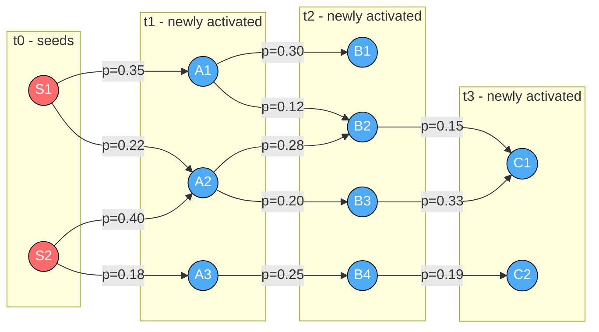
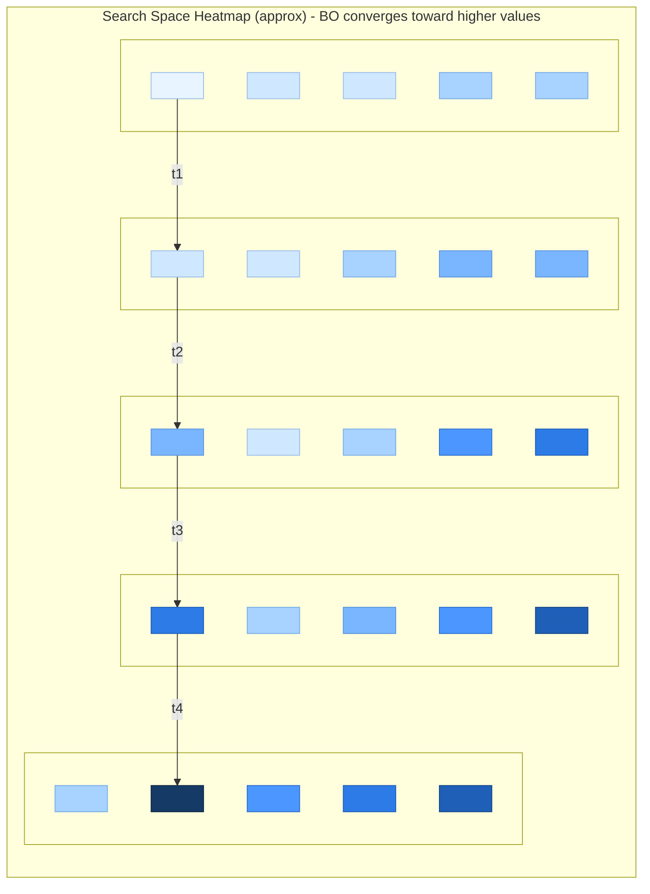
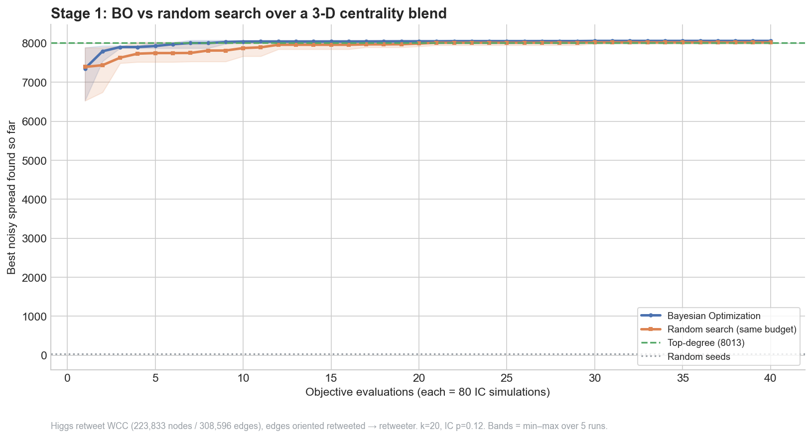
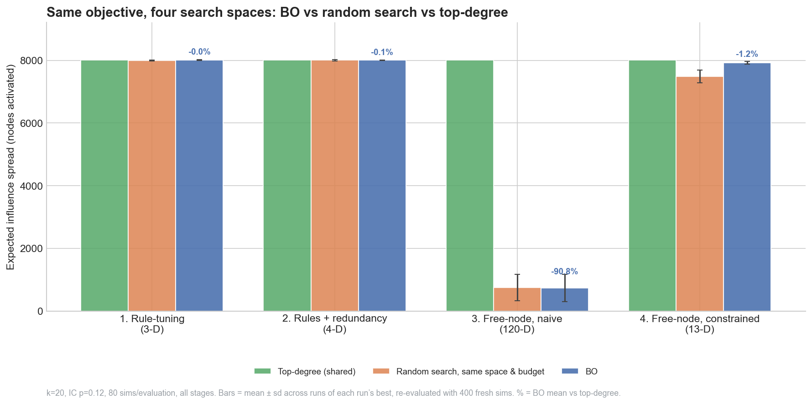
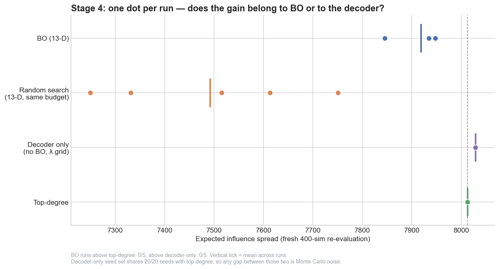
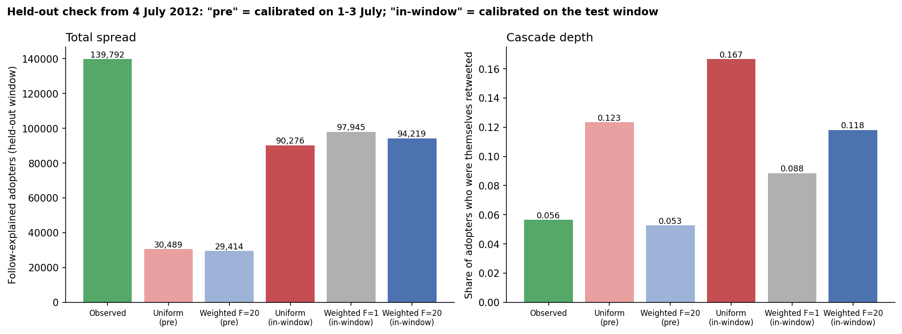
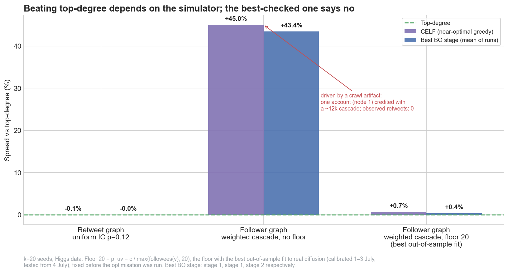

> **Correction and update, November 2026.** An audit of this post found that its three "BO vs random" figures were generated from hand-coded mock curves, not from any experiment, and that two diagrams and a "BO improves reach by ~20–50%" claim had no experimental basis. All of them have been removed. The post also claimed that applying BO to influence maximization was new; it is not, and that section now says what this work actually adds. Separately, the real-graph results were checked against real diffusion data and rerun on the follower graph; that section has been extended with the outcome.

## The Core Question

Most AI systems ask:

> *Can we predict what will go viral?*

Prediction assumes trends are passive - something we observe after they emerge.

But trends are not passive.

They are shaped by decisions:

- who sees content first  
- when it is posted  
- how it is amplified  
- where visibility expands  

So the real question becomes:

> **Can we optimize the conditions under which trends emerge?**

This is where Bayesian Optimization (BO) enters.

---

## The Big Idea

Instead of treating virality as a prediction problem, we treat it as a **black-box optimization problem**.

### Traditional pipeline:

Data → Model → Prediction

### New pipeline:

Decision → Propagation → Feedback → Optimization → Better Decision

The shift is subtle - but profound.

We move from observing trends to engineering them.

---

## Trends as Propagation Systems

A trend doesn’t appear instantly. It propagates through stages.

### 1. Engagement Initiation

Early signals emerge:

- likes  
- comments  
- shares  
- watch time  

These become a feature vector:

'x ∈ ℝ^d'

---

### 2. Amplification

Influencers and network structure drive spread:

- resharing velocity  
- high-degree nodes  
- algorithmic boosts  

Amplification introduces uncertainty - exactly what BO exploits.

---

### 3. Visibility Expansion

Algorithms increase exposure:

- explore pages  
- trending feeds  
- recommendations  

This stage determines whether content dies or explodes.

---

### 4. Virality

Sustained exponential spread occurs across the network.

This becomes the optimization target.

---

## The Optimization Problem

Instead of predicting virality directly:

'max_{x ∈ X} f(x)'

Where:

- x = trend seeding strategy  
- f(x) = influence spread (unknown)

We cannot write this function analytically.

We can only evaluate it.

That makes it a perfect black-box optimization problem.

---

## Influence Spread as the Objective

We evaluate f(x) using the **Independent Cascade (IC) model**.

### Independent Cascade Simulation

1. Seed nodes activate.  
2. Activated nodes attempt to activate neighbors with probability \(p_{uv}\).  
3. Process repeats until no new activations occur.

Expected influence:

'f(x) = E_IC[Reach(S_x)]'

Estimated using Monte Carlo simulations.

Each evaluation is expensive - which is exactly where BO shines.

---

## Bayesian Optimization Core

### Surrogate Model

'f(x) ~ GP(μ(x), k(x, x'))'

Gaussian Processes model:

- predicted influence  
- uncertainty over unknown regions  

---

### Acquisition Function

'a(x) = μ(x) + κ σ(x)'

This is the Upper Confidence Bound (UCB) rule. It balances:

- exploitation (high-performing strategies)  
- exploration (uncertain but promising strategies)

The real-graph experiments below use a different acquisition rule, Expected Improvement (defined in the maths section), which makes the same trade-off.

---

### Sequential Loop

1. Evaluate initial strategies  
2. Train GP surrogate  
3. Optimize acquisition function  
4. Test new strategy  
5. Update model  
6. Repeat  

Optimization becomes intelligent exploration.

---

## Visualizing the Process

### IC Spread Simulation

---

### Acquisition Function Evolution

How BO decisions evolve over iterations:

- uncertainty decreases  
- exploration shifts toward promising regions  

---

### Search Space Trajectory

---

## Performance vs. Random Seeding: How to Compare Fairly

A simple baseline for trend seeding is **random selection**:

- pick seed users randomly (or randomly choose strategy knobs like time/hashtags/influencer tier)
- run the propagation simulation (IC / Monte Carlo)
- record reach / engagement / virality

Random search is easy and unbiased. Bayesian Optimization learns from every evaluation and uses a surrogate model plus an acquisition function to decide where to test next. Whether that adaptivity pays off under a fixed budget is an empirical question, and the answer depends heavily on the search space (see the real-graph results below).

---

### What we compare

Assume the objective is expected reach:

'f(x) = E_IC[Reach(S_x)]'

We compare two methods under the same budget \(N\):

- **Random**: sample (x1, x2,....., xN) uniformly from the strategy space
- **BO**: adaptively choose \(x_{t+1} = \arg\max a(x)\) after each evaluation

---

### Metrics used for comparison

1. **Best-So-Far Influence (Simple & Strong)**  
   Measures progress as optimization proceeds:

'BestSoFar(t) = max_{i ≤ t} f(x_i)'

If BO is earning its keep, this should rise faster than random search's.

2. **Area Under the Best-So-Far Curve (AUBC)**  
   A single-number summary of sample efficiency:

'AUBC = Σ_{t=1}^{N} BestSoFar(t)'

Higher AUBC means you achieved strong performance earlier and consistently.

3. **Regret (Optimization Lens)**  
   If we assume the true optimum is \(f(x^*)\), the simple regret is:

'r_N = f(x*) − max_{t ≤ N} f(x_t)'

Lower regret under an equal budget is the claim a BO-vs-random comparison has to demonstrate.

4. **Stability Under Noise (Propagation Variance)**  
   Since Monte Carlo IC estimates are stochastic, compare variance:

'Var(f(x)) ≈ (1 / (K − 1)) Σ_{k=1}^{K} ( Reach_k(S_x) − Ȓeach(S_x) )²'

BO can incorporate uncertainty and avoid being misled by noisy single samples.

---

Two rules make the comparison fair: both methods get exactly the same number of objective evaluations, and each run's best answer is re-scored with fresh simulations so the noisy maximum doesn't flatter either method.

---

## Real-Graph Research Artifact: the Higgs Network

The research-artifact version runs on the SNAP Higgs Twitter data, with a seed budget of **k = 20**. It was first run on the retweet graph (**223,833 nodes**, **308,596 edges**), then checked against real diffusion and rerun on the follower graph (below).

> **Correction, November 2026.** An earlier version of this section said BO beat
> the top-degree heuristic on the Higgs graph by a few percent. That came from a
> bug: the graph's edges pointed against the direction information flows. After
> fixing it and rerunning with matched controls, **BO does not beat top-degree on
> this graph.** Top-degree is effectively optimal, and CELF selects the same 20
> accounts.

*Retweet graph: BO reaches the top-degree plateau in fewer evaluations than random search (about 6 vs 12 to get within 1%), but the plateau is top-degree itself.*

*The search-space design decides whether BO can reach the baseline. It matches it in small degree-anchored spaces, gets within about 1% in a constrained subset space, and collapses in a naive 120-D space. It never exceeds it.*

*In the constrained 13-D space, BO clearly beats random search with the same budget but still finishes about 1.2% below top-degree.*

### Checking the simulator against real diffusion

Every comparison above happens inside a simulator, and the retweet graph has a structural problem as a simulation substrate: each of its edges is a retweet that already happened. Exposure on Twitter runs along follow edges, and the Higgs release includes both the follower graph (456k users, 14.9M edges) and a timestamped log of the week's retweets. So the simulator can be tested.

- **Follow edges carry most diffusion.** 59% of retweets come from a follower of the source. On the follower graph, the top-20 accounts' audiences overlap 44–65%, against 13% on the retweet graph. That is the regime where diversity-aware seeding *should* beat top-degree.
- **Calibrate before, test after.** A weighted cascade (each follower's activation probability shrinks with the number of accounts they follow) was calibrated on 1–3 July and tested from 4 July. Out of sample it reproduces how shallow real cascades are (depth 0.053 vs 0.056 observed) but under-predicts total spread about 4.7×, because people became roughly three times as likely to retweet once the discovery was announced.

*Held-out check against the real activity log. Calibrated before the announcement, every model under-predicts spread; weighted cascade matches cascade depth.*

- **The optimisers found a hole in the data.** Run naively on the follower graph, CELF and BO "beat" top-degree by +45% and +43%. Almost all of that came from one account: in the crawled data, 16,280 of its followers follow no one else, so the model treated it as a 12,000-node spreader. In the real log it was **never retweeted once**. The crawl only recorded follows among Higgs-involved users, so followee counts are truncated, and optimisers go straight for the accounts a model overrates. After a correction chosen by out-of-sample fit (a floor on the followee count, fixed before rerunning), the gain disappears.
- **Per account, the model is no smarter than follower count.** Across the 3,000 candidate accounts, the model's predicted reach correlates with observed retweets at about 0.5 (Spearman), and 8 of its top 20 are in the observed top 20, exactly what ranking by follower count achieves.

*Whether anything beats top-degree depends on the simulator. On the retweet graph, nothing does. On the naive follower-graph model, a data artifact produces a +45% "win". On the follower-graph model that best fits real diffusion, the best seeding found is within 1% of top-degree.*

On the corrected follower-graph simulator, top-degree remains within 1% of the best seeding found (CELF +0.7%), and BO adds nothing over random search with the same budget in the rule spaces. Heavy audience overlap costs little because any one follower's chance of being activated is small, so being reached twice is rare.

Two lessons carry beyond this graph. Search-space design decides whether BO can reach a strong answer, not whether one exists. And an optimiser is only as trustworthy as the simulator it is pointed at: it will find and exploit the simulator's errors, so the simulator needs checking against real outcomes, account by account, before its optimum means anything. None of this establishes what a real seeding campaign would achieve; that needs a field experiment. The code, data provenance and every number are in the [validation write-up](https://github.com/ChinmayA301/blog-artifacts/tree/main/virality-bayesian-optimization/validation). For the full build log, see [Influence Maximization using BO](/blog/influence-maximization-bayesian-optimization-higgs/).

---

## Approach B: The Same Network, Different People

There is a methodological weakness in the experiment above.

The Higgs topology is real. The behavior moving through it is not.

Independent Cascade models commonly give every eligible edge the same activation probability, or draw those probabilities from an arbitrary distribution. That is useful for isolating graph structure. It also assumes that everybody is equally likely to activate on every kind of content.

They are not.

A technically literate node should not respond to an ML paper in the same way it responds to a sports clip. A highly social, video-oriented node may reverse that ordering. So Approach B replaces the single global probability with a topic-conditional one:

'logit p(u → v | c) = logit p₀ + β₁ affinity(v,c) + β₂ share(v) + β₃ similarity(u,v,c)'

The persona signals come from the [public MatrAIx release](https://huggingface.co/datasets/MatrAIx2026/MatrAIx_Persona_1M_Public_Release), which exposes 1,290 categorical dimensions spanning technical familiarity, interests, psychology, lifestyle, and media behavior. The first implementation builds two deliberately different content profiles:

- an **ML paper**, using machine-learning familiarity, technology and science interest, technical literacy, need for cognition, and reading preference;
- a **sports clip**, using sports interest, sports exposure, video preference, excitement seeking, and social-media attitude.

BO now searches over four interpretable weights: topology, topic affinity, sharing propensity, and neighborhood redundancy. The question becomes more specific:

> **Which structurally strong nodes are plausible first adopters for this particular content?**

### The conditioning problem is part of the model

There is no identity join between a MatrAIx persona and an anonymous Higgs node. Randomly sampling 223,833 global personas would not recreate Twitter's user distribution during the July 2012 Higgs discovery. Pretending otherwise would turn synthetic enrichment into fake ground truth.

So the implementation treats persona assignment as an explicit sensitivity parameter. It runs three assumptions about how strongly a node's observed graph activity aligns with a sampled persona's platform-fit score:

- `0.00`: random assignment;
- `0.35`: weak alignment;
- `0.70`: strong-alignment stress test.

A result that disappears across this grid is assumption-sensitive, not robust.

The initial audit of the 999-row decoded public sample (395 of those records are themselves synthetic by MatrAIx's own source labels; the rest are derived from Wikipedia, Stack Overflow, Amazon reviews, the General Social Survey and smaller sources) found 665 age-eligible records and an effective sample size of 652.8 after soft conditioning. The requested fields are usable but incomplete: coverage ranges from 18.0% to 77.0%. The ML-paper and sports-clip affinity scores are meaningfully distinct in the sample (correlation = -0.225). That is enough to run the mechanism as a synthetic sensitivity experiment. It is **not** evidence about the actual preferences of Higgs users.

### Three-tier provenance

| Layer | What it is | What can be claimed |
|---|---|---|
| Network | Real [SNAP Higgs retweet topology](https://snap.stanford.edu/data/higgs/web/twitter-higgs.html) | The edges and graph structure are observed data |
| People and behavior | Synthetic persona-to-node assignments and assumed activation coefficients | A controlled modeling scenario, not reconstructed user behavior |
| Method | Heterogeneous IC simulation, Monte Carlo evaluation, and Gaussian-process BO | A reproducible topic-conditional influence-maximization method |

Even a human-grounded MatrAIx record becomes synthetic metadata once it is assigned to an anonymous graph node. The honest output is therefore a robustness study over assumptions, not a claim that the model discovered who those Twitter users really were.

The implementation, conditioning audit, tests, and reporting contract are in the [Approach B research artifact](https://github.com/ChinmayA301/blog-artifacts/tree/codex/persona-conditioned-bo/virality-bayesian-optimization). The full 223,833-node performance result is intentionally not reported until the cached Higgs graph is supplied and every conditioning value is run.

---

## What This Work Adds (and What It Doesn't)

Bayesian Optimization for influence maximization is not new. Earlier work, including several of the references below, applies BO to seed selection and to functions over node subsets. What this project contributes is narrower:

- a comparison of four search-space designs on the same real graph, under one objective, with random search on the same budget as the control;
- a test of the simulator itself against real diffusion data (the follower-graph validation below), which most influence-maximization studies skip;
- a public correction record: the first version of these results came from a bug, and the corrected and validated numbers replaced them.

---

## Why Not Reinforcement Learning?

RL works best when:

- dense rewards exist  
- continuous interaction is available  

Here:

- evaluations are expensive  
- rewards are delayed  
- sample efficiency matters  

That makes BO a natural first choice here, though this project does not compare it against RL, so that is a design argument rather than a measured result.

RL remains a future extension.

---

## Challenges & Limitations

No idea is perfect.

Key challenges include:

- high evaluation noise from Monte Carlo simulations  
- local traps in optimization space  
- high-dimensional strategy vectors  
- GP scalability limitations  

These motivate future research directions.

Notes / Caveats 
	•	BO can be misled by noise if (K) is too small (not enough MC rollouts).
	•	BO may fall into local traps if exploration is too low.
	•	Random can look competitive in extremely high noise or poorly specified search spaces.

So comparisons will include:
	•	confidence intervals over multiple runs (repeat experiments with different random seeds)
	•	optionally varying (K) (MC rollouts) to show robustness.
  
---

## The Deeper Insight

### Traditional view

BO optimizes vectors.

### New view

BO navigates complex social decision spaces.

This reframes social systems as:

- structured optimization landscapes  
- sequential experimentation environments  

---
## The Mathematical Engine Behind Trend Optimization

At the heart of this system is a precise mathematical framework that turns social propagation into an optimization problem. Below is a conceptual breakdown of each core equation and how it connects to virality engineering.

---

### 1. Estimating Influence Spread

'E_IC[Reach(S_x)] ≈ (1 / K) Σ_{k=1}^{K} Reach_k(S_x)'

This equation approximates the **expected influence spread** under the Independent Cascade (IC) model.

- (S_x) = seed set selected by strategy \(x\)
- {Reach}_k(S_x)) = number of activated nodes in simulation \(k\)
- (K) = number of Monte Carlo simulations

Because influence propagation is stochastic, we simulate it multiple times and average the results. This gives us a stable estimate of expected virality.

Each evaluation is computationally expensive - making Bayesian Optimization ideal.

---

### 2. Constructing the Virality Score

'ViralityScore(x) = Σ_i w_i · f_i(x)'

Virality is not a single signal - it is a weighted combination of measurable engagement features:

- (f_i(x)) = engagement feature (e.g., share velocity, clustering coefficient, watch-time retention)
- (w_i) = learned importance weight

This linear aggregation transforms raw social signals into a structured objective function.

---

### 3. Learning Optimal Feature Weights

'L(w) = - Σ_{t=1}^{T} ( y_t - Σ_i w_i f_i(x_t) )²'

This loss function learns weights \(w_i\) that best align predicted virality with observed viral outcomes.

- (y_t) = observed virality outcome at time \(t\)
- (x_t) = strategy used
- (T) = number of training instances

As written, this is ordinary least squares (maximising the negative squared error), which has a closed-form solution; BO would add nothing for a linear model. BO becomes useful only if the score is a non-linear or non-differentiable function of its weights. None of the experiments in this post use this score.

---

### 4. Acquisition Functions (Decision Rule)

Bayesian Optimization does not optimize the true function directly. It optimizes a *surrogate model* and uses acquisition functions to choose the next evaluation.

#### Expected Improvement (EI)

'a_EI(x) = E[ max(0, f(x) - f(x⁺)) ]'

- f(x⁺) = best observed value so far

EI chooses strategies expected to outperform the current best - balancing exploration and exploitation.

---

#### Upper Confidence Bound (UCB)

'a_UCB(x) = μ(x) + κ σ(x)'

- μ(x) = predicted mean
- σ(x) = uncertainty
- κ  = exploration parameter

UCB explicitly trades off:

- Exploitation (high predicted influence)
- Exploration (high uncertainty)

---

### 5. Strategy Selection

'x* = argmax_{x ∈ X} a(x)'

The next strategy tested is the one that maximizes the acquisition function.

This is the core decision-making step in Bayesian Optimization.

---

### 6. Gaussian Process Kernel Functions

The surrogate model uses kernels to measure similarity between strategies.

#### Radial Basis Function (RBF)

'k_RBF(x, x') = exp( - ||x - x'||² / (2ℓ²) )'

- Smooth, infinitely differentiable
- Assumes gradual changes in influence landscape
- Controlled by length-scale \(\ell\)

---

#### Matérn Kernel

'k_Matern(x, x') = (2^(1-ν) / Γ(ν)) · ( (√(2ν) ||x - x'||) / ℓ )^ν · K_ν( (√(2ν) ||x - x'||) / ℓ )'

- More flexible than RBF: it allows a rougher (less smooth) objective
- Controlled by smoothness parameter \(\nu\)
- Observation noise is handled separately, by adding a white-noise term to the kernel

---

### 7. Edge Activation Probability

'p_uv'

This represents the probability that an activated node \(u\) activates neighbor \(v\) in the Independent Cascade model.

These probabilities encode:

- strength of connection
- historical interaction frequency
- platform-specific influence likelihood

---

## Why This Matters

These equations collectively transform:

- engagement signals  
- network structure  
- uncertainty  
- propagation randomness  

into a **sequential optimization framework**.

Rather than predicting trends passively, this framework:

1. Models uncertainty over virality  
2. Selects promising strategies  
3. Learns from outcomes  
4. Improves future decisions  

The mathematics is not just descriptive - it is prescriptive.

It enables AI to navigate social systems intelligently.

---

## Future Directions

Where this research can go next:

- Graph Neural Network surrogates  
- RL-based adaptive strategies  
- Multi-fidelity Bayesian Optimization  
- Dynamic, evolving social graphs  
- Real-time autonomous trend engineering  

This is where sequential decision-making and BO begin to merge.

---

## The Big Idea - Final Thought

Most systems try to predict trends after they happen.

This work asks something different:

**What if AI could learn how to create them?**

By combining influence propagation models with Bayesian Optimization, we move from passive forecasting toward active, uncertainty-aware decision making.

Sometimes optimization isn’t about finding the answer.

It’s about learning how to move through the space.

---

## References

- Kempe et al. (2003). *Maximizing the Spread of Influence through a Social Network*  
- Snoek et al. (2012). *Practical Bayesian Optimization*  
- García-Hernández et al. (2022). *Bayesian Optimization for Influence Maximization*  
- Liang (2024). *Bayesian Optimization of Functions over Node Subsets in Graphs*  

---

## Author Note

Written as part of my exploration in **AI for Sequential Decision Making**  
MS Data Science - University of Minnesota
