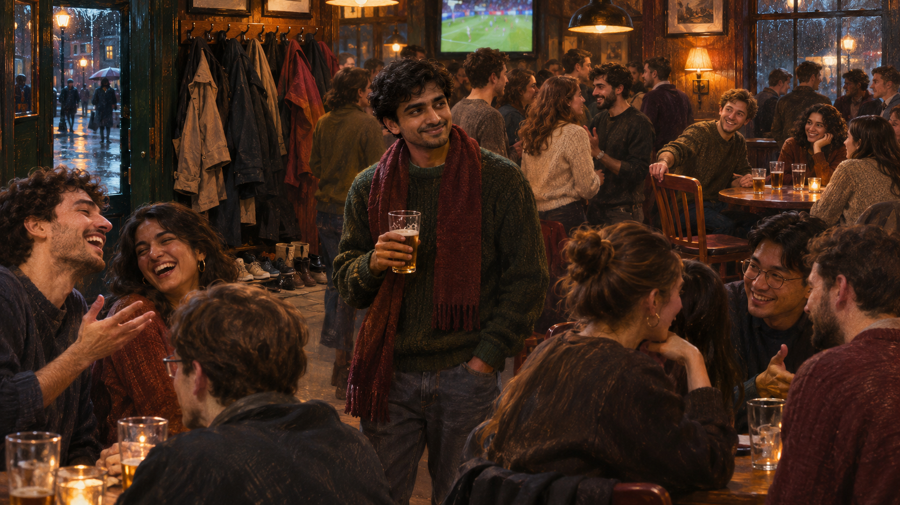

*He recognizes the match, the song, and the joke. What has not travelled with him is shared history. Illustration generated for this essay.*

## I knew the joke

The room was loud enough that every conversation required a small lean forward.

Someone made a reference to a show I had watched in Delhi. I laughed at the right beat. I knew the sport on the television above the bar, the song underneath the crowd noise, the shoes by the door, the rhythm of the conversation.

Then the group turned back toward itself.

Nothing dramatic happened. Nobody insulted me. There was no slammed door, only the soft architecture of people who already had stories together. They knew who had dated whom, which school produced which kind of person, where to go after midnight, how seriously to take a particular invitation. I knew the culture on the screen. I did not know the room.

I moved halfway across the world expecting a new culture. Instead, I found a culture I already understood, except nobody knew who the fuck I was.

## The culture had arrived before I did

I grew up in Delhi with the internet open.

American television arrived on the same laptop as Indian comedy. European football occupied weekend evenings. Music, clothes, memes, games, interviews, and arguments crossed borders long before I did. English was not a special costume I put on at the airport. The references that were supposed to produce culture shock had already been sitting in my bedroom for years.

This was not every Indian childhood. It was mine: urban, English-speaking, highly online, and shaped by access that many people did not have. Family, class, school, city, and generation matter. “Indian immigrant” is too broad a category to explain what any one person believed the West would feel like.

I expected difference anyway. I imagined learning new codes, being startled by ordinary habits, and slowly becoming fluent.

Instead, I arrived fluent in the visible layer.

That may have made the invisible layer more surprising.

## Culture is portable; social history is not

Culture can be consumed at a distance. Social position cannot.

I could know why the joke was funny without knowing whether I was permitted to make it. I could understand the activity without being included in the next plan. I could speak easily with a person for twenty minutes and still not know how acquaintances became friends in that place.

Back home, identity had infrastructure.

There were people who remembered earlier versions of me. There were roads I could navigate without looking at a map, restaurants attached to particular years, friends-of-friends who placed me inside a web before I opened my mouth. My personality did not need to explain itself from zero at every table.

Abroad, the same person arrived without witnesses.

The loss was not only loneliness. It was compression. A complicated identity became the few details that crossed the room first: Indian, male, foreign, maybe technical, maybe new. The rest had to fight its way out sentence by sentence.

## The internet had prepared a version of me

Before I entered the room, the room was not empty.

It contained online caricatures of Indian men: accents flattened into punchlines, social awkwardness treated as ethnicity, technical competence mixed with sexual undesirability, scam calls, immigration arguments, arranged-marriage jokes, and the endless recycling of a few images into a supposed personality.

Not everybody believed these stereotypes. Few people announced them plainly. That is not how most social perception works.

It appeared in smaller moments: surprise at how I spoke, a joke offered as a test, a dating interaction that felt like a category decision, an assumption that I would understand one kind of work and not another. Sometimes I could not tell whether I had encountered prejudice, ordinary disinterest, my own awkwardness, or the fact that adult friendship is difficult everywhere.

Uncertainty is part of the experience. It makes every interaction available for replay later.

Was that about me? Was it about being new? Did I misread the room? Am I using identity to explain something more mundane? Am I refusing to name what was obvious?

There is no clean instrument for measuring a social atmosphere while standing inside it.

## The unexpected downgrade

Immigration is often described through gain: education, income, safety, professional opportunity, mobility. Those gains can be real and substantial. They coexist with a social demotion that is harder to place on a form.

At home, I had accumulated context. Abroad, I became introductory.

Every meeting began with origin. Every friendship started at chapter one. Professional credentials might transfer; humor, trust, desirability, and reputation did not transfer at the same rate. Even confidence changed when it no longer received familiar feedback.

This is the part of moving that photographs hide. The skyline is impressive. The apartment keys are new. The first grocery receipt looks strange. Then Saturday arrives, bright and empty, and the city reveals that access to a place is not access to its people.

The social downgrade can feel especially sharp when cultural familiarity led you to expect continuity. If everything appears legible, exclusion feels less like translation failure and more like personal failure.

## Geography changes the experiment

“Moving to the West” is not one social condition.

New York is not a small university town. London is not a suburban office park. A city with layered immigrant communities offers more possible rooms than a place where everybody's closest friendships began in secondary school. Housing, transport, work hours, weather, and the presence of public gathering spaces all alter the probability of belonging.

In a large city, anonymity can be freedom. It can also become efficient loneliness. In a smaller place, repeated contact can build intimacy, or the narrowness of the social field can make difference impossible to escape.

The institution matters too. A university manufactures recurring encounters. Remote work removes them. A workplace may supply colleagues without supplying friends. The same person can feel charismatic in one geography and nearly invisible in another because the surrounding machinery of contact has changed.

This is why immigrant advice that focuses only on confidence feels incomplete. Confidence needs somewhere to land.

## Four bad options, then some better ones

At first, reinvention looks like a choice among uncomfortable strategies.

I can adapt to the version of me other people recognize, sanding off anything that produces friction.

I can fight every perception, turning each conversation into a small trial about India, masculinity, immigration, or race.

I can retreat entirely into familiar communities, gaining ease while narrowing the experiment of moving.

Or I can attempt a new identity so aggressively that the performance exhausts me.

None is sufficient.

The better answer has been less cinematic: repeated presence. Return to the same field, café, gym, class, office, or living room. Invite before waiting to be invited. Let people see competence and awkwardness in more than one setting. Find Indians with whom “Indian” is the beginning of specificity rather than the end. Find non-Indians who are curious without treating friendship as field research.

Belonging grows through accumulated, ordinary evidence.

This is frustrating because the life left behind already had accumulation. Starting again feels like a downgrade precisely because it is one. There is no shortcut around shared time.

## Social shock is not cultural superiority

There is a smug version of this essay in which I announce that globalization made me worldly while the people I met remained trapped inside stereotypes. That version would be satisfying and false.

I carried my own simplifications. Consuming another culture's media did not mean I understood its class codes, racial history, regional differences, politeness, dating norms, or everyday vulnerability. Recognition made me overestimate knowledge.

The internet showed me exported culture: the jokes that travelled, the arguments that became content, the neighborhoods that appeared on camera. It did not show the full social texture of being raised there.

I was culturally fluent in the way someone can know every lyric without knowing the person who wrote the song.

Social shock was the correction.

## Being known again

Months later, I enter another room.

Somebody waves before I reach the table. A friend moves a jacket from the empty chair. There is a story already in progress, and this time part of it belongs to me. The change is physically small: a chair made available, a drink ordered without asking, my name used in a sentence before I introduce myself.

That is what I had been missing.

Not cultural knowledge. Recognition.

Moving did not place me inside a new culture as if I had stepped into a museum exhibit. It removed the social proof that once surrounded me and asked me to rebuild identity among people whose first impression had been shaped by distance, media, and their own histories.

I still know the joke. Now, sometimes, I know the room too.
