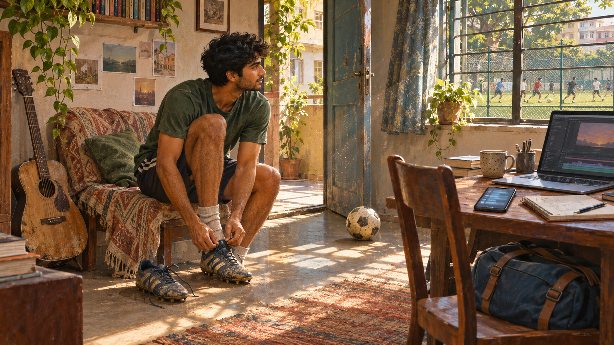

*The guitar, project, messages, and travel bag remain in the room. Choosing football for one morning does not erase them. Illustration generated for this essay.*

## Saturday morning, four possible lives

At nine, somebody is already playing football on the field across the road.

I can hear the ball strike the wire fence from my apartment: metal, pause, somebody shouting, metal again. My guitar is leaning against the wall with a thin coat of dust on the shoulders. A half-built project waits on the laptop. Three friends have sent messages about plans I have not answered.

By noon, the day will feel used.

This is the strange arithmetic of my twenties. I finally have enough freedom to begin almost anything, and every beginning makes the things I did not choose more visible.

I spent my childhood wanting the freedom to do everything. Now that I have it, I can't figure out what to do first.

## The child with time and no authority

As a child in Delhi, wanting was cheap.

I could want to play football seriously, learn an instrument, become excellent at another sport, build strange machines, write, travel, and acquire a completely different personality by the following summer. The desires could sit beside one another because none had yet demanded a lease, a career decision, or five thousand deliberate hours.

I did try things. Children in India do not grow up inside a single grey machine, and it would be dishonest to turn my experience into a national rule. Family income changes what is available. So do neighborhood facilities, school culture, parental expectations, safety, gender, city, class, and the adults who happen to notice a child's ability. Some children receive deep support. Others encounter ten interests and no structure that lets one become a serious practice.

My life contained curiosity, but not always continuity.

A sport could be intense for a season and then disappear with an exam schedule. Music could remain an object in the room instead of becoming a discipline. An interest had to compete with the clean, legible route: study, perform, qualify, move forward.

Nobody needed to forbid exploration. The timetable could do it quietly.

## The adult with authority and no empty time

Adulthood reverses the problem.

Now I can sign up for the class. I can buy the ticket. I can choose the city, change the job, start the company, call the person, join the league, and stay up until three learning something for no reason except that I want to know it.

But every choice arrives carrying consequences.

The hour at the football field is an hour not spent on the project. The evening class occupies the night a friendship needed. A career change touches rent. Travel interrupts a routine that took months to make stable. The body needs sleep even when the mind has found a new obsession.

Freedom is not the absence of constraint. It is the power to decide which constraints to accept.

That sounds noble until I am staring at a calendar, trying to fit a second life between Tuesday at seven and Thursday at nine.

## You are expected to build everything at once

The phrase “build a life” sounds like one project. In practice, it is several construction sites sharing the same delivery truck.

There is work: skill, reputation, money, and the question of whether ambition is turning into anything real.

There is the body: strength, sleep, food, injury, and the slow recognition that maintenance cannot be deferred without interest.

There are friendships, which once grew from physical proximity and now require calendars, flights, voice notes, and the courage to admit when distance is becoming neglect.

There is love. There is family. There is mental health. There is a home that needs to feel like somewhere a person lives rather than a charging station beside a bed.

There is identity, somehow expected to supervise all the other departments while still under construction itself.

Each part can absorb every available hour. None accepts being described as optional.

On a bad week, the attempt to balance them produces a peculiar form of paralysis. I do not rest because there is too much to do. I do not begin because beginning the wrong thing feels expensive. I move small tasks around a screen until the evening is gone.

## The lives become more specific as they disappear

The fear of choosing is not only fear of making a mistake. It is grief for the person who will not exist if the choice succeeds.

Take one job and another city fades. Commit to one craft and the beginner's excitement of three others remains permanently available in imagination. Build a relationship and the solitary version of the future closes. Stay independent and another kind of intimacy becomes hypothetical.

These unlived lives are seductive because they contain no laundry.

The musician I did not become never practices scales while tired. The entrepreneur in the alternate timeline never misses payroll. The athlete does not wake with a bad knee. The version of me who moved to another country always finds the right friends by the second month.

Reality has friction. Possibility is polished smooth.

Comparing the two is unfair, but I do it anyway.

## Optionality can become a hiding place

Keeping every door open feels intelligent. It can also become a way of never entering a room.

I have sometimes treated interests like browser tabs: too important to close, too numerous to examine, steadily consuming memory in the background. The collection itself becomes an identity. I am the kind of person who *could* learn this, build that, move there.

Potential is flattering because it cannot be measured.

Practice can.

The moment I choose, fantasy turns into a calendar. The guitar needs twenty minutes today, not an imagined future in which I play beautifully. The friendship needs a call. The body needs to be moved. The project needs a bad first version sitting on the screen.

Choice removes the protective distance between who I might be and what I am willing to do on a wet Wednesday evening.

## A season is not a sentence

The only model that has made this easier is to stop treating every serious choice as a permanent identity.

Some commitments are lifelong. Many are seasonal.

For twelve weeks, one physical practice can be primary. For six months, a project can receive the first hours of the morning. A friendship going through a hard period can temporarily outrank a professional ambition. An instrument can be played badly for pleasure without becoming a second career.

This is not the fantasy of “having it all.” It is sequencing.

~~~text
not everything now
does not mean
not ever
~~~

Sequencing also reveals which desires survive contact with routine. An interest that remains alive after boredom, inconvenience, and slow progress may deserve another season. One that disappears has still taught me something. Exploration is not wasted because it fails to become identity.

The point is not to optimize a life until every hour produces a return. That would turn freedom into another exam. The point is to create enough structure that desire can become experience instead of remaining a beautiful, accusing list.

## What I want from the next decade

I do not want one perfect life chosen early and defended forever. I want a life with a spine strong enough to support several chapters.

That requires accepting limits. The body occupies one place. The week contains 168 hours. Attention given fully to one person cannot simultaneously be given fully to another. No productivity system negotiates these facts away.

It also requires refusing a different lie: that a serious adult must become narrow. A person can build depth without amputating curiosity. The shape may be slower than childhood imagined. It may involve returning to an old interest at thirty-two, becoming a beginner in public, or doing something badly without converting it into a side hustle.

Across the road, the football hits the fence again.

I close the laptop. Not forever. For the morning.

The life I choose today does not prove that the others were false. It gives one of them a body, a field, and two hours of actual weather.
