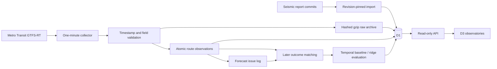

# Live Data Lab

Two portfolio observatories backed by an independent scheduled collector and Cloudflare D1. No browser requests directly ingest source feeds. No synthetic records are used in the deployed dashboards.

- [Seismic observatory](https://chinmay-live-data-lab.chinmayarora30.workers.dev/observatories/seismic/)
- [Transit reliability lab](https://chinmay-live-data-lab.chinmayarora30.workers.dev/observatories/transit/)

## What exists

The seismic importer pins every metric/status/quality bundle to the same upstream Git commit. It checks the printed status values against raw metrics within their rounding precision before storing them. Initial history comes from up to twelve published metric revisions; revisions without compatible reports are skipped and recorded. The upstream model runs every six hours; the importer checks every fifteen minutes. The UI shows actual workflow history, temporal-test metrics, catalog/scored counts, and exported validation checks.

The transit collector fetches official Metro Transit trip updates and vehicle positions every minute. It validates source timestamps and full-dataset semantics, preserves gzip-compressed raw payloads with SHA-256 hashes, and commits normalized route-direction observations and forecasts atomically. It keeps one upcoming, explicitly delayed stop event per unique trip. Missing delays never become zero. Invalid coordinates, absent/stale vehicle timestamps, and stale feeds are excluded or rejected. The route labels come from the provider's NexTrip endpoint.

Vehicle validation tolerates a verified provider defect: repeated entity IDs can pair an untimestamped `(0,0)` placeholder with a real observation. Invalid rows are excluded first. Remaining records are resolved by entity ID and physical vehicle ID, retaining the newest valid observation. Conflicting equally recent coordinates/routes, or one entity ID identifying distinct vehicles, exclude the affected group. The API's `position_quality` reports repeated IDs, invalid rows, redundant observations, and ambiguous conflicts; `invalid_positions` is the total excluded record count. Each physical vehicle appears at most once. Trip-update entity ID collisions still reject the feed. Original raw bytes remain available for replay; this tolerance does not repair the upstream feed or invent coordinates.

Ten-minute persistence and damped-trend forecasts are issued before outcomes. Source-feature time, response capture time, and actual forecast issue time are stored separately; targets are ten minutes after the issue time. Outcomes are later matched to a provider estimate for the same route-direction at or within 90 seconds after the target. The initial trend rule is not a trained model. A ridge candidate is fitted only after sufficient matched history, with a temporal holdout and a purge so training outcomes precede test issues. The all-network series uses a trip-weighted rollup; changes in the reporting trip mix can change it.

These are **provider delay estimates**, not independently measured actual arrivals. Neither a transit accuracy gain nor an operational service-quality improvement is claimed in advance. Empty outcomes remain unavailable until real history accrues.

## Data flow



## Local setup and checks

Requires Node 24 or newer; the checked-in lockfile fixes the installed dependency tree.

```sh
cd live-data
npm ci
npm run types
npm run check
npm test
npm run build
npx wrangler d1 migrations apply DB --local
npm run dev
```

`wrangler dev --test-scheduled` exposes a local-only scheduled-event test route. Trigger it with:

```sh
curl http://127.0.0.1:8787/__scheduled
```

The generated static HTML includes the verified deployed API origin for use in the Jekyll portfolio. To test the local API in a browser, remove the `data-api` attribute in the generated `public/observatories/*/index.html` files; do not edit source or deploy that local override. API tests can call the local endpoint directly. No endpoint allows a public caller to run collection or mutate stored data.

## Deployment

This project owns the D1 database named in `wrangler.jsonc`; do not point migrations at another project's database.

```sh
npm run build
npm run types
npm run check
npm test
npx wrangler deploy --dry-run
npx wrangler d1 migrations apply DB --remote
npx wrangler deploy
```

The existing Cloudflare login supplies deployment credentials; no token is committed. The deployed cron is `* * * * *`. A short database lease suppresses overlapping collectors. New/changed cron triggers can take time to propagate; verify persisted source timestamps from independent runs before claiming the schedule is operating.

## API and replay

- `GET /api/health`: service time and latest attempt times.
- `GET /api/seismic`: stored upstream reports, workflow statuses, importer attempts, and export limitations.
- `GET /api/transit?route=all&window=6h`: latest accepted feed, two-minute chart bins, forecasts/evaluation, model gates, run health, and replay archive coverage. `route` can be a returned route-direction key and `window` can be `24h`.
- `GET /api/transit/raw?kind=tripupdates&snapshot=<returned-id>`: retained compressed source bytes. `kind=vehiclepositions` retrieves the other feed. The checksum header identifies the uncompressed bytes.

Verify that stored raw inputs reproduce the accepted normalization:

```sh
npm run replay -- https://chinmay-live-data-lab.chinmayarora30.workers.dev
npm run acceptance -- https://chinmay-live-data-lab.chinmayarora30.workers.dev
```

Replay uses the **original capture time** for source-age validation; it does not pretend an old feed is a new live observation.

## Retention, failures, and limits

- Raw replay: a six-hour retention target and a 64 MiB cleanup budget, applied hourly. Objects can remain until the next cleanup. This is bounded diagnostic history rather than an unlimited data lake.
- Quarantine: invalid/stale payloads, a six-hour retention target and a 16 MiB cleanup budget, applied hourly.
- Normalized observations and forecasts: seven days. Full per-snapshot position payloads are compacted after six hours; the latest accepted state remains available. Attempt logs: thirty days. Seismic report revisions remain stored.
- Upstream payloads are read with a size bound and timeout. Transit feeds retry transient HTTP/network errors once, with two ten-second attempt limits. Permanent HTTP errors and size-contract violations are not retried. Source timestamps more than three minutes old or thirty seconds in the future fail validation. Vehicle observations must also be at most three minutes old against the capture clock.
- Repeated/older timestamps cannot replace current state. A different payload with the same primary feed timestamp is quarantined rather than silently changing issued forecasts.
- Failed collection retains the last accepted snapshot. The UI shows source age, failed attempts, and stale state; it does not substitute fabricated readings.
- Ridge fitting requires at least 80 matched records, 40 eligible training cases, 15 held-out cases, and a held-out span of at least fourteen minutes. Fitting is bounded to 16 recently active groups (including the network rollup) and 180 matched records per group, checked every thirty minutes. These are implementation eligibility thresholds, not proof of adequate statistical power. Overlapping forecast windows remain correlated.
- A feature-drift series and event-level seismic scores are not published by the upstream repo. The observatory does not invent either. The original upstream scored table also covers more than the held-out test set; catalog flag rate is not a held-out accuracy metric.

The SQLite integration tests check atomicity, idempotency, raw replay, outcome timing, missing outcomes, and revision handling. Domain tests check missing/default protobuf fields, invalid locations/timestamps, cancellations, temporal leakage, and upstream report consistency. Real-feed and browser acceptance evidence is recorded in `../docs/LIVE_DATA_AUDIT.md`.

The duplicate-placeholder regression fixture is a three-entity subset of a real feed captured on November 12, 2026; its source URL, capture time, and complete original payload hash are recorded in `tests/fixtures/metro-duplicate-vehicle.json`. Additional conflict and retry scenarios are explicitly test fixtures. Acceptance requires a successful latest attempt and fresh timestamps from both feeds; an old successful snapshot cannot make a failing collector pass.
